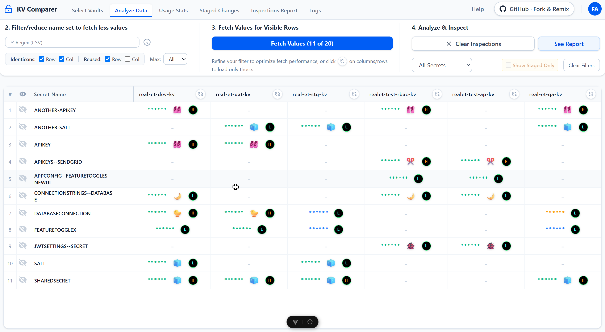

# InvestoFinDevSecDisOps

An Azure Operations Helper, made with .NET 10 and Vue.js to help you navigate Azure environments, vaults, pipelines and Azure Dev Ops Libraries, and variable groups. Including a release matrix, an approval matrix to see all your last and previous deployments and compare them side-by-side, by branch, repo, version, tag, container version, etc.


## Table of Contents
- [Features & Ribbon Tabs](#features--ribbon-tabs)
- [Prerequisites](#prerequisites)
- [Authentication](#authentication)
- [Quick Start](#quick-start)
- [Manual Startup](#manual-startup)
- [Sign-In Technology & Architecture](./docs/signin-technology.md)
- [Features & System Specifications](./FEATURES.md)
- [Azure Key Vault API Strategies](./azure-keyvault-api-strategies.md)




## Features & Ribbon Tabs
- **Select Vaults**: Connect and organize target Azure Key Vaults and AWS Secrets Manager environments.
- **Fetch Values**: Compare secrets side-by-side with visual identicons highlighting duplicate or missing values.
- **ADO Libraries**: Compare Azure DevOps variable groups against Key Vaults.
- **Pipelines & Releases**: Interactive matrix and DAG of builds, stages, versions, and rollbacks ($N-1$).
- **Inspections**: Security audit detecting unrotated secrets, weak passwords, and entropy anomalies.
- **Code**: Generate code snippets and configuration templates from secret definitions.
- **Staged Changes**: Safely stage and review secret updates before applying changes or exporting PowerShell scripts.
- **Logs**: Real-time observability for API requests, authentication, and background jobs.

## Prerequisites
- [.NET 10 SDK](https://dotnet.microsoft.com/download)
- [Node.js](https://nodejs.org/) (v18+ recommended)
- [Azure CLI](https://docs.microsoft.com/en-us/cli/azure/install-azure-cli)

## Authentication
Follow the sign-in message on top of the web page upon load.

[Know more about sign-in technology](./docs/signin-technology.md).

## Security
**Important:** For security reasons, the backend API is strictly restricted to the machine where it runs (bound to `127.0.0.1` via `appsettings.json`). It cannot be accessed externally over the local network.

## Quick Start
To start both the backend and frontend simultaneously, simply run the provided PowerShell script from the root directory:
```powershell
.\start-all.ps1
```

## Manual Startup
If you prefer to start the services individually:

### 1. Start the Backend (.NET API)
```bash
cd KeyVaultComparer.Api
dotnet run
```
The API will be available at `http://localhost:5065`

### 2. Start the Frontend (Vue 3 + Vite)
```bash
cd keyvaultcomparer-ui
npm install
npm run dev
```
The UI will be available at `http://localhost:5173`


