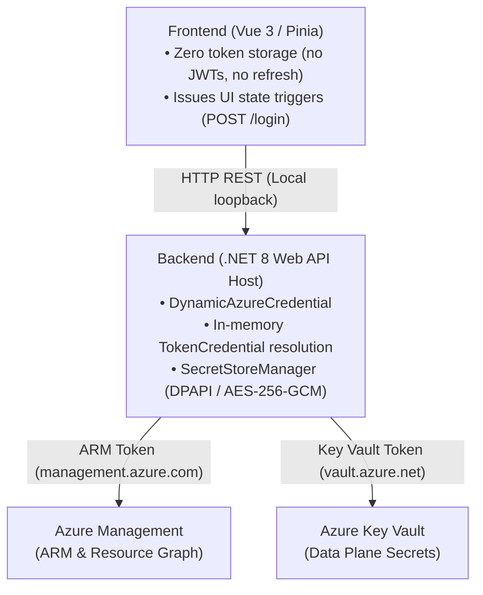
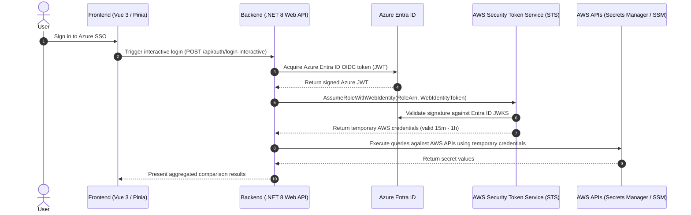

# Sign-In Technology & Authentication Architecture

This document details the authentication architecture, token handling lifecycle, frontend security posture, and multi-cloud extension patterns for KeyVaultComparer (InvestoFinDevSecDisOps).

---

## 1. Overview & Architectural Pattern

The application implements a **Backend-for-Frontend (BFF) / Local Agent** security architecture. 

All interaction with identity providers (IdPs), token exchange endpoints, and downstream cloud APIs is centralized within the .NET backend. The browser frontend acts strictly as a presentation and control surface.



---

## 2. Authentication Flow & Technology Stack

### 2.1 Credential Resolution (`DynamicAzureCredential`)

Authentication is managed via `DynamicAzureCredential`, which inherits from Azure Core's `TokenCredential`. The credential resolves authentication tokens in a deterministic priority order:

1. **Service Principal Mode (Headless / Automated)**:
   - Configured via Settings (`AzureTenantId`, `AzureClientId`, and encrypted `AzureClientSecret`).
   - Resolved via Azure SDK `ClientSecretCredential`.
   - Used in automated deployments, Docker containers, or headless CI/CD runners where interactive browser sessions are unavailable.
2. **Interactive Browser SSO (Fallback)**:
   - Instantiated as `InteractiveBrowserCredential` using Microsoft's pre-consented public Azure CLI Client ID (`04b07795-8ddb-461a-bbee-02f9e1bf7b46`).
   - The backend launches the system's default browser and establishes an ephemeral loopback HTTP listener to capture the OAuth2 authorization code callback via PKCE.
   - Eliminates the requirement for dedicated enterprise Azure AD / Entra ID application registrations or tenant admin consent.
3. **Azure CLI Session Delegation (Primary Interactive Method)**:
   - When interactive login is triggered, the backend inspects host PATH for the `az` executable via `where.exe` (Windows) or `which` (Linux/macOS).
   - Spawns `cmd.exe /c az login` or `az login`.
   - Azure CLI securely acquires and caches tokens in the local user profile (`~/.azure/`).
   - Subsequent calls seamlessly delegate through `AzureCliCredential`.

### 2.2 Interactive Login Endpoint

- **Route**: `POST /api/auth/login-interactive`
- **Controller**: Registered in `Program.cs` calling `DynamicAzureCredential.LoginInteractiveAsync()`.
- **Response**:
  ```json
  {
    "success": true,
    "message": "Successfully authenticated via Azure CLI."
  }
  ```

---

## 3. Frontend Token Footprint & Exposure

### 3.1 Token Absence in Frontend

The frontend (`keyvaultcomparer-ui`) **never receives, parses, or stores any Azure tokens**.

- **No Access Tokens**: The browser never receives OAuth2 Bearer tokens.
- **No Refresh Tokens**: Refresh tokens remain sealed in the backend memory or Azure CLI credential cache.
- **No Client Secrets**: Client secrets and personal access tokens (PATs) are posted directly to the backend settings endpoint and never stored in client-side state.

### 3.2 State Probing (`/api/auth/status`)

The UI monitors authentication state using a non-blocking probe:
- **Route**: `GET /api/auth/status`
- **Payload**:
  ```json
  {
    "isConnected": true,
    "state": "connected",
    "authMethod": "InteractiveSSO",
    "profile": {
      "email": "developer@company.com",
      "initials": "DC",
      "subscriptionName": "Azure Cloud Active",
      "tenantId": "00000000-0000-0000-0000-000000000000"
    }
  }
  ```

---

## 4. Backend Cloud Authorization

When backend services interact with Azure, tokens are dynamically acquired per scope:

| Target Service | Endpoint / Scope | Acquired By |
|---|---|---|
| **Azure Resource Manager (ARM)** | `https://management.azure.com/.default` | `ArmClient` & Subscription enumeration |
| **Azure Key Vault (Data Plane)** | `https://vault.azure.net/.default` | `SecretClient` (per Key Vault instance) |
| **Azure DevOps REST API** | `499b84ac-1321-427f-aa17-267ca6975798/.default` | `AdoAuthService` (AAD Bearer token exchange) |
| **Microsoft Graph** | `https://graph.microsoft.com/.default` | `ProfileService` (user photo & identity resolution) |

Tokens are injected into outbound HTTP requests as standard headers:
```http
Authorization: Bearer <in-memory-azure-ad-jwt>
```

---

## 5. Security & Threat Analysis

### 5.1 Client Storage Isolation

| Storage Mechanism | Contents | Risk Level |
|---|---|---|
| `localStorage` | UI layout states (`adoPipelineColWidth`, `adoHiddenEnvironments`, `adoRecentPipelineIds`) | Zero credential risk |
| `sessionStorage` | None | None |
| Browser Cookies | None | None |

Because credentials and authorization tokens do not exist in the DOM or browser storage, Cross-Site Scripting (XSS) attacks in the frontend cannot exfiltrate cloud access tokens.

### 5.2 Server-Side Secret Storage

Credentials supplied via the UI Settings panel (Azure Client Secret, Azure DevOps PAT, GitHub PAT) are persisted strictly on the backend host via `SecretStoreManager`:

- **Windows**: Encrypted at rest using Windows Data Protection API (DPAPI) via Windows Credential Manager (`Advapi32.dll`). Keys are tied to the local user account security identifier (SID).
- **Linux / Docker**: Encrypted at rest via authenticated AES-256-GCM in `secrets.enc`.

---

## 6. Multi-Cloud Extension: AWS Authentication via Azure Identity

The architecture supports integrating AWS services (e.g., AWS Secrets Manager, SSM Parameter Store) without provisioning long-lived AWS IAM access keys, using **OIDC Workload Identity Federation**.

### 6.1 Architectural Workflow



### 6.2 Configuration Steps

1. **Configure OIDC Identity Provider in AWS IAM**:
   - Register an OpenID Connect (OIDC) provider in AWS IAM.
   - Provider URL: `https://sts.windows.net/<azure-tenant-id>/` (or `https://login.microsoftonline.com/<azure-tenant-id>/v2.0`).
   - Audience: Client ID of the Azure application registration.
2. **Configure AWS IAM Role & Trust Policy**:
   - Create an IAM Role in AWS with permissions for Secrets Manager (`secretsmanager:GetSecretValue`, etc.).
   - Trust policy condition:
     ```json
     {
       "Version": "2012-10-17",
       "Statement": [
         {
           "Effect": "Allow",
           "Principal": {
             "Federated": "arn:aws:iam::<aws-account-id>:oidc-provider/sts.windows.net/<azure-tenant-id>/"
           },
           "Action": "sts:AssumeRoleWithWebIdentity",
           "Condition": {
             "StringEquals": {
               "sts.windows.net/<azure-tenant-id>/:aud": "<azure-client-id>"
             }
           }
         }
       ]
     }
     ```
3. **Backend Credential Exchange**:
   - Backend acquires an Azure Entra ID token scoped to the AWS client ID.
   - Passes the token to `AmazonSecurityTokenServiceClient.AssumeRoleWithWebIdentityAsync(...)`.
   - Uses the resulting `SessionAWSCredentials` to instantiate `AmazonSecretsManagerClient`.
4. **Security Advantage**:
   - Zero static AWS keys (`AKIA...`) stored on host or in config.
   - Centralized identity revocation: disabling the Azure AD account automatically revokes access to AWS resources.
